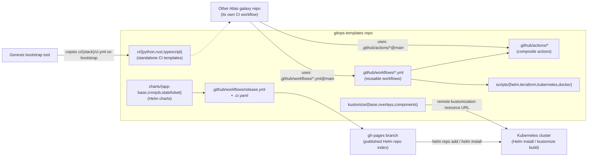

# Architecture — gitops-templates

## What this repo is

`gitops-templates` is **not a running service**. It is the shared DevOps
template library for the Atlas workspace: reusable GitHub Actions workflows,
composite actions, Helm charts, Kustomize bases, standalone CI templates, and
shell scripts that every other "galaxy" (repo) in the Atlas constellation
pulls in rather than reimplementing. Consumers reference this repo's contents
by Git ref (`@main`), by pinned Helm chart version, or via a one-time file
copy performed by the Atlas bootstrap tool ("Genesis").

## Components

| Directory | What it provides |
|-----------|-------------------|
| `.github/workflows/` | Reusable workflows (`on: workflow_call`) for Python, Rust, TypeScript, Helm, Terraform, and Docker — quality, test, build, security, and release jobs — plus this repo's own CI/release/pages workflows |
| `.github/actions/` | Composite actions (`setup-python`, `setup-rust`, `setup-node`, `setup-helm`, `setup-terraform`) that install toolchains and caches for the reusable workflows |
| `ci/{python,rust,typescript}/` | Standalone, per-stack CI config (`ci.yml`, lint/pre-commit/deny/dependabot configs) that Genesis copies verbatim into a brand-new galaxy at bootstrap time, before that galaxy has its own pipeline |
| `charts/app-base/` | Base Helm chart for a standard Deployment + Service + Ingress + HPA + ServiceAccount workload |
| `charts/cronjob/` | Helm chart for CronJob-shaped workloads |
| `charts/statefulset/` | Helm chart for StatefulSet workloads |
| `kustomize/base/` + `kustomize/overlays/` + `kustomize/components/` | Kustomize base (ServiceAccount, Deployment, Service, ConfigMap, HPA, Ingress) with optional components and an example overlay, offered as an alternative to Helm consumption |
| `scripts/{helm,terraform,kubernetes,docker}/` | Shell scripts (`lint-all.sh`, `package.sh`, `deploy.sh`, `plan.sh`, `validate.sh`, `kubeconform.sh`, `rollout-wait.sh`, `build.sh`, `push.sh`) used both by this repo's own CI and copy/pasted or invoked by consumer galaxies |
| `examples/` | Worked usage examples: sample Helm values files, reusable-workflow call examples per stack, a Terraform plan workflow example |
| `tests/` | Shell-based template tests (`test_*_template.sh`) that render charts/kustomize output and assert on the rendered manifests |
| `.cr.yaml` | `chart-releaser` config used by `.github/workflows/release.yml` to publish charts to GitHub Pages |

## Tech stack / tooling targeted

- **Helm 3** — chart packaging, `values.schema.json` validation, `chart-releaser` publishing to a `gh-pages` Helm repo
- **Kustomize** — an alternative, patch-based consumption path for the same base manifests
- **GitHub Actions** — the primary distribution mechanism: reusable workflows and composite actions consumed with `uses: luukjuh123/gitops-templates/...@main`
- **kubeconform** — schema validation of rendered Kubernetes manifests
- **Terraform** (`fmt-check.sh`, `validate.sh`, `plan.sh`) and **Docker** (`build.sh`, `push.sh`) helper scripts/workflows
- Per-language CI tooling: `uv`/pre-commit/safety for Python, `cargo-deny`/dependabot for Rust, ESLint/Prettier for TypeScript

This repo is consumed by: other Atlas galaxies' GitHub Actions pipelines
(`uses:` references), a cluster's Helm/ArgoCD/Flux-style GitOps flow (via the
published Helm repo or a `kustomize` remote resource URL), and the Genesis
bootstrap tool that copies the `ci/{stack}/` templates into new galaxies.
It does not itself run in a cluster — it has no deployed application code,
only templates and the automation that packages/publishes them.

## How it fits together

## How this was produced

Archify (github.com/tt-a1i/archify) is an interactive agent-skill for chat
sessions (Cursor/Claude Code/Codex/OpenCode) that renders typed JSON IR into
HTML/SVG inline in a chat — it is not a scriptable, batch-mode static-analysis
CLI, so it could not be run headlessly against this repo. This document was
instead hand-written by an AI agent that read the repository's README,
CLAUDE.md, workflow/action/chart/kustomize files, and directory structure
directly.
